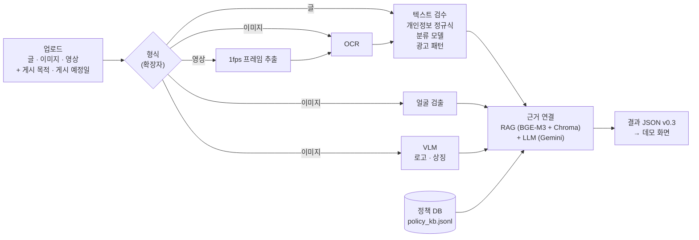

# beFore · AI 콘텐츠 사전 검수

광고·SNS 콘텐츠를 **게시하기 전에** 검사해서, 문제가 될 표현이 **어디에 있고, 왜 문제인지**를 실제 법령·플랫폼 정책 조항과 함께 알려주는 검수 도우미입니다.

- 입력: 글(.txt 또는 직접 입력) · 이미지(.jpg .png) · 1분 이하 영상(.mp4 .mov)
- 출력: 항목별 **위반 / 검토 필요 / 통과** 판정 + 위험도 + 문제 구간 + 근거 조항 + 확인 질문
- 원칙: AI가 확신하기 어려운 항목은 억지로 판정하지 않고 **"검토 필요"** 로 사람에게 넘깁니다

> 심층학습 프로젝트 (2026 2학기) · 팀 17

---

## 목차

1. [무엇을 검사하나](#1-무엇을-검사하나)
2. [동작 흐름](#2-동작-흐름)
3. [폴더 구조](#3-폴더-구조)
4. [서버에서 실행하기](#4-서버에서-실행하기)
5. [모델·데이터](#5-모델데이터)
6. [평가와 결과 파일](#6-평가와-결과-파일)
7. [알려진 한계](#7-알려진-한계)
8. [팀 작업 규칙](#8-팀-작업-규칙)

---

## 1. 무엇을 검사하나

| 영역 | 항목 | 방법 | 판정 |
| --- | --- | --- | --- |
| 혐오·유해 | 집단 비하(출신·외모·연령·성별·종교·인종), 욕설 | 분류 모델 (KcELECTRA 파인튜닝) | 위반 / 검토 필요 |
| 민감 맥락 | 정치적 표현 | 분류 모델 | 검토 필요 |
| 개인정보 | 전화번호·주민번호·이메일·계좌 | 정규식 | 위반 |
| 광고 규정 | 과대·과장 광고 (`100% 개선`, `부작용 없는` …) | 패턴 사전 | 위반 / 검토 필요 |
| 광고 규정 | 광고·협찬 표시 누락 | 광고성 신호 점수 + 표시 문구 유무 | 위반 (목적=광고) / 검토 필요 |
| 이미지 | 이미지 속 글자 → 위 항목 전부 | OCR (PaddleOCR) | 위와 같음 |
| 이미지 | 인물 (초상권·AI 가상인물 표시) | 얼굴 검출 (OpenCV YuNet) | 검토 필요 |
| 이미지 | 타사 로고·캐릭터 / 역사·외교 민감 상징 | VLM (Gemini) | 검토 필요 |
| 영상 | 1초에 1장 프레임 → 이미지 검수 재사용 → 같은 문제는 시간 구간으로 병합 | | 위와 같음 |
| 날짜 | 게시 예정일이 3·1절·현충일 등 특별한 날이면 안내, 시행 예정 규정은 그 날짜 기준으로 판단 | | 안내 |

판정마다 붙는 **근거 조항**은 정책 DB(공정위 지침·법령·Meta·YouTube·Google 정책 등)에서 RAG로 찾고, LLM은 그 후보 중에서 고르기만 합니다. 후보에 없는 조항은 버리므로 조항을 지어내지 않습니다.

## 2. 동작 흐름



- 진입 함수: `pipeline.run(text, purpose)` (글) / `pipeline.run_file(path, purpose, input_id, post_date)` (파일 → 형식 자동 판별)
- 결과 형식: 노션 **출력 JSON 형식 v0.3** 페이지 참고. 데모 화면(`app.py`)은 이 JSON만 읽어서 그리고, 판정 로직은 없습니다

## 3. 폴더 구조

```text
.
├── app.py                 데모 UI (Gradio) ─ 업로드 화면 → 분석 중 → 검수 결과
├── pipeline.py            전체 흐름 연결: 글 / 이미지 / 영상 분기, 최종 JSON 조립
├── config.yaml            LLM 모델 이름 · 서버 경로
├── requirements.txt
├── .env.example           GEMINI_API_KEY 형식 (실제 .env는 올리지 않음)
│
├── data/                  K-MHaS 로더, 정상 광고 문구, 테스트 이미지 I1–I8
├── models/                분류 모델 예측 함수 · 평가 함수        (README 있음)
├── notebooks/             분류 모델 학습 실험 v0–v7
├── rules/                 개인정보 정규식, 광고 패턴(yaml)
├── rag/                   정책 DB 만들기 · 검색
├── llm/                   Gemini 호출, 근거·안내 문장 생성
├── vision/                OCR, 얼굴 검출
├── vlm/                   이미지 속 로고·상징 판단
├── video/                 영상 프레임 추출 · 영상 검수
├── utils/                 게시 예정일 · 특별한 날
│
├── eval/                  동작 확인·평가 스크립트
│   ├── a_test_*.py        모듈별 동작 확인 (마지막 줄 OK 확인)
│   ├── rag_eval.py        RAG 검색 Recall@k
│   ├── video_eval/        합성 영상 평가셋 만들기 · 평가
│   └── data/              평가 데이터 (정답 라벨, 자막 이미지, RAG 정답셋)
└── results/               실험 결과 정리 (.md · .csv · 학습 로그)
```

GitHub에 **없는** 것 (용량·권리 문제로 서버에만 있음): 모델 가중치 `checkpoints/`, 벡터DB `/nfs/team/vectordb`, PaddleOCR 환경 `/nfs/team/b_ocr_compare/paddle_env`, 영상 평가셋 mp4·배경 영상, `.env`

## 4. 서버에서 실행하기

모든 명령은 학과 서버(`ss-team17`)의 `~/project`에서 실행합니다.

### 처음 한 번

```bash
cd ~/project
source .venv/bin/activate              # uv 가상환경 (Python 3.11)
cp .env.example .env                   # GEMINI_API_KEY 채우기
```

패키지는 이미 `.venv`에 설치돼 있습니다. 새 패키지가 필요하면 `uv pip install 이름` 후 `requirements.txt`에 한 줄 추가합니다 (`pip install` 직접 사용 금지).

### 데모 실행

```bash
python app.py
```

1. VS Code 아래쪽 **포트** 탭에서 7860 확인 → 브라우저에서 `localhost:7860`
2. 다 쓰면 터미널에서 `Ctrl+C` (상시 실행·`screen`·`nohup` 금지, `share=True` 금지)
3. 껐다 켜면 **첫 검수만** 모델 로딩 때문에 느립니다 → 시연 직전에 한 번 돌려두기

### 코드에서 바로 부르기

```python
import pipeline

pipeline.run("이 크림 하나면 주름 100% 개선! 프로필 링크에서 쿠폰코드 SALE10", purpose="none")
pipeline.run_file("data/images/I6.png", purpose="ad", post_date="2026-11-27")
pipeline.run_file("eval/data/video_eval/videos/V01.mp4")
```

`purpose`: `ad`(광고·홍보) · `info` · `daily` · `fun` · `etc` · `none`(선택 안 함, 기본)

### 정책 DB를 바꿨을 때

구글 시트(정책·논란 사례 DB)를 고친 뒤:

```bash
python rag/build_kb.py      # 시트 → rag/policy_kb.jsonl
python -m rag.search        # 바뀐 행만 다시 임베딩 → "N개 문서" 확인
```

### 동작 확인

| 명령 | 확인하는 것 |
| --- | --- |
| `python -m eval.a_test_predict` | 분류 모델 출력 모양 |
| `python -m eval.a_test_ad_patterns` | 광고 패턴 예시 13개 |
| `python -m eval.a_test_explain` | RAG 근거 + LLM 문장 |
| `python eval/a_test_image_pipeline.py` | 이미지 흐름 구조 (모델 없이) |
| `python eval/a_test_image_pipeline.py --real data/images/I7.png` | 이미지 실제 모델 |
| `python eval/video_eval/validate_video_set.py` | 영상 평가셋 구조 |

## 5. 모델·데이터

| 단계 | 사용 | 비고 |
| --- | --- | --- |
| 위반 유형 분류 | `beomi/KcELECTRA-base` 파인튜닝 (**v5**) | 직접 학습하는 유일한 모델. 제곱근 class weight, 5 epoch |
| 판정 임계값 | 0.4 미만 통과 / 0.4–0.8 검토 필요 / 0.8 이상 위반 | 정치는 0.4 이상이면 검토 필요 |
| 정책 검색 | `BAAI/bge-m3` + Chroma | 위반 유형·게시 목적·게시 예정일 필터 |
| 근거 문장 · VLM | Gemini (`config.yaml`) | 후보 조항 중 고르기만 함 |
| OCR | PaddleOCR 3.4.1 | 별도 가상환경에서 실행 (공용 `.venv`와 의존성 충돌) |
| 얼굴 검출 | OpenCV YuNet | MediaPipe는 서버 라이브러리 문제로 제외 |

| 데이터 | 용도 | 라이선스 |
| --- | --- | --- |
| [K-MHaS](https://github.com/adlnlp/K-MHaS) 뉴스 댓글 109,692건 | 분류 모델 학습·평가 | CC-BY-SA-4.0 (HuggingFace에서 로드) |
| 정책 DB (`rag/policy_kb.jsonl`) | RAG 근거 | 직접 수집 (법령·공정위·플랫폼 공개 문서) |
| 정상 광고 문구 (`data/b_normal_ads.csv`) | 과대광고 오탐률 | 공개 프로모션 문구 수집 |
| 합성 영상 10개 | 1fps 노출 시간별 탐지율 | 배경은 Pexels 영상 (출처: `eval/data/video_eval/background_sources.csv`, 원본은 저장소에 없음) |

## 6. 평가와 결과 파일

검증 데이터만으로 모델·임계값을 골랐고, K-MHaS 공식 **test는 W9 최종 평가 때 한 번만** 씁니다.

| 결과 | 핵심 수치 (validation) | 파일 |
| --- | --- | --- |
| 분류 모델 비교 v1–v7 | v5 macro F1 **0.8066** / micro F1 0.8800 (seed 3개 평균 macro 0.805 ± 0.004) | `results/b_model_compare.md` |
| 판정 임계값 | 위반 Precision 0.78 · Recall 0.89 (0.4 / 0.8, v3 기준) | `results/b_threshold.md` |
| 오류 분석 30건 | 라벨 애매 15 · 문맥 6 · 다중 라벨 5 · 은어 3 · 키워드 1 | `results/b_error_analysis.md` |
| RAG 검색 | Recall@3 20/20 (정책 18개 기준, W5) | `results/b_rag_eval.md` |
| 정상 광고 오탐 | 30개 중 0개 | `results/b_normal_ads_eval.md` |
| 영상 OCR (합성 10개) | 문장 전체 정확 일치 1/18 | `eval/data/video_eval/ocr_eval_all_summary.json` |
| 영상 텍스트 경고 (합성 10개) | 문제 영상 8개 중 7개 경고 (0.5초 자막 1개는 1fps에서 미포착) | `eval/data/video_eval/video_text_eval_summary.json` |

- RAG 정답셋은 W8에 정책 26개로 늘리면서 권리(로고·초상) 질문 5개를 추가했습니다 → `python -m eval.rag_eval` (결과: `results/rag_eval.md`)
- 영상 합성셋 수치는 그 결과를 보고 얼굴 필터를 조정했으므로 **개발용 예비 수치**입니다 (최종 평가는 새로 만든 합성셋 권장)

## 7. 알려진 한계

- **1fps 영상 검수**: 1초 미만으로 잠깐 나오는 자막은 샘플링 시점에 따라 놓칠 수 있습니다 (비용과의 절충)
- **문장 나누기**: 문장부호 기준이라 마침표 없는 댓글은 통째로 한 문장이 됩니다
- **광고 패턴**: `시험 100% 망했다`처럼 문맥과 상관없이 `100%`에 걸리는 경우가 있습니다
- **얼굴 검출**: 사람이 있는지만 봅니다. AI 생성 여부나 초상권 침해 여부는 판단하지 않습니다. 영상은 24px 미만 얼굴 후보를 버립니다 (임시 기준)
- **VLM**: 없는 것을 있다고 할 수 있어 항상 "검토 필요"로만 안내합니다
- **정책 DB**: 수동으로 모은 26개 조항 범위 안에서만 근거를 찾습니다

## 8. 팀 작업 규칙

- GPU는 1장 공유 → 학습 전에 `nvidia-smi` 확인 + 카톡
- 공용 파일(`requirements.txt`, `config.yaml`, `.gitignore`)을 고칠 때는 카톡 한 줄 먼저
- 파일 담당: `pipeline.py`·`app.py`·`llm/`·`vlm/` = A / `models/`·`rag/`·`vision/`·`video/`·`utils/` = B. 상대 파일은 직접 고치지 않고 요청
- 학습 결과는 `checkpoints/v{번호}/final/`에, 정리는 `results/*.md`와 노션 **결과물 모음** 페이지에
